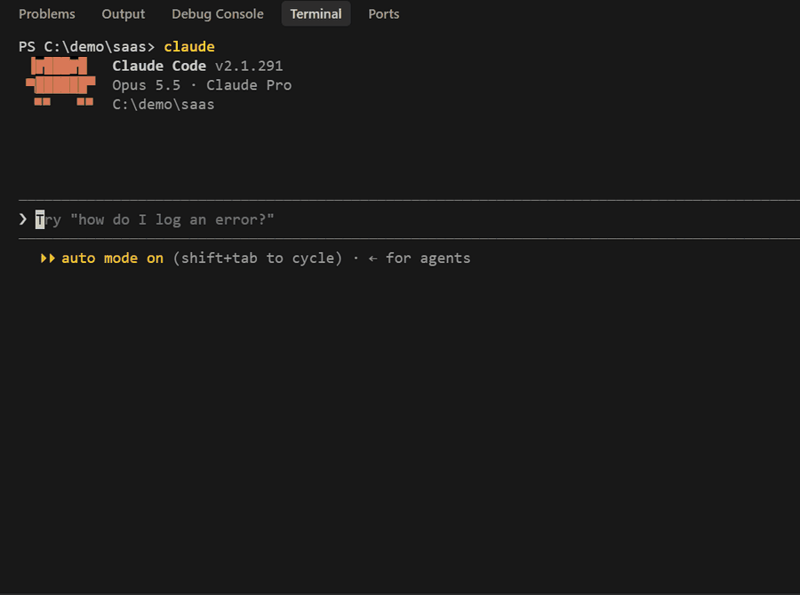

# Claude Harness Bootstrap

[](LICENSE)
[](https://github.com/sagaga144/claude-harness-bootstrap/releases)
[](#tested-not-just-prompted)
[](https://claude.com/claude-code)
[](#quickstart)

Describe your project in one paragraph. Get a complete, project-specific Claude Code
setup: `CLAUDE.md`, guard hooks, reviewer agents and slash commands.



## Quickstart

**Listed in Anthropic's plugin directory** for Claude Code, Cowork and Claude apps, after
Anthropic's security scan and review. In Claude Code:

```
/plugin install harness-bootstrap@anthropic-plugin-directory
```

or open `/plugin` and find **harness-bootstrap** in the directory.

Or install it straight from this repository:

```
/plugin marketplace add sagaga144/claude-harness-bootstrap
/plugin install harness-bootstrap@harness-bootstrap
```

The directory updates after each release passes Anthropic's review, so it can trail this
repository by a version.

Then, in any project folder (empty or existing):

```
/harness-bootstrap:init
```

Describe your project. You'll get two quick questions (how much to keep Claude usage cost
down, and whether to build just the essentials or the full setup now), each with a
recommended answer already picked. You don't need to know what a hook or a subagent is.

You can also skip the slash command and just describe a new project. The skill triggers
on the description alone.

## See what it generates

Real output, committed as generated. This is the `.claude/` tree for a Rust + React SaaS
monorepo with real auth and payment data
([description](examples/monorepo-saas/INPUT.md)):

```
.claude/
├── agents/
│   ├── backend-engineer.md
│   ├── correctness-reviewer.md     # also checks frontend/backend type drift
│   ├── db-guard.md                 # accounts and billing data
│   ├── frontend-engineer.md
│   ├── planner.md
│   └── security-reviewer.md        # auth + payments
├── commands/
│   └── verify.md
├── hooks/
│   ├── build-gate.cjs
│   ├── critical-rules.cjs
│   ├── guard-bash-push.cjs
│   ├── guard-harness.cjs           # security baseline: the harness protects itself
│   ├── guard-remote-exec.cjs       # security baseline: no running fetched code
│   ├── post-edit-notes.cjs
│   ├── protect-files.cjs
│   └── secret-scan.cjs
├── rules/
│   ├── backend.md
│   ├── contracts.md
│   └── frontend.md
├── skills/
│   └── add-endpoint/SKILL.md
├── BUGS.md
└── settings.json                   # ask rules on the harness, sandbox on
```

Seven examples, each a different shape:
[SaaS monorepo](examples/monorepo-saas/) ·
[Terraform on AWS](examples/terraform-aws-infra/) ·
[multiplayer game server](examples/multiplayer-game-server/) ·
[Solidity marketplace](examples/solidity-nft-marketplace/) ·
[JUCE audio plugin](examples/juce-audio-plugin/) ·
[ML paper reproduction](examples/ml-paper-reproduction/) ·
[desktop notes app](examples/desktop-notes-app/).
[`examples/README.md`](examples/README.md) says what each project's traits changed in its
harness.

## Tested, not just prompted

The plugin ships with an eval suite in [`plugin/evals/`](plugin/evals/). Each case is a
real Claude Code session that gets a project description, with graders that check what
came out, and can also run once without the plugin, for comparison.

**Latest result (v0.7.1, Claude Code 2.1.299, 2026-10-14): 12 of 12 on Haiku, 12 of 12 on
Sonnet**, one run per case, with the plugin. v0.7.0 passed 9 of 12 on each; v0.6.1 passed
3 of 8 on Haiku and 3 of 6 on Sonnet in the same setup (the 8 of 8 it reported was the
account's default model). Eval runs
can't write into `.claude/`, so graders check `CLAUDE.md` and what the session tried to
write, and the generated hooks are tested separately (see [What it blocks](#what-it-blocks)).

| Case | What it checks | Haiku | Sonnet |
|---|---|---|---|
| `self-triggers-on-bare-description` | A plain project description, with no mention of Claude Code or setup, is enough to start it. | pass | pass |
| `two-guided-questions` | The two setup questions (cost, scope) actually get asked. | pass | pass |
| `web-app-auth-db` | An authenticated web app with a database plans a security reviewer and a data-layer guard, a secret scan, and no semver reviewer. | pass | pass |
| `published-library-semver` | A library published to PyPI gets a semver / breaking-change reviewer and a lean, placeholder-free `CLAUDE.md`. | pass | pass |
| `vague-description` | "I want to build an app" gets one question and a stack-neutral harness, not a guessed stack. | pass | pass |
| `cli-no-ui-no-persistence` | A local-files CLI gets no UI reviewer or persistence guard, dev commands match its toolchain, and `CLAUDE.md` stays lean. | pass | pass |
| `retrofit-existing-repo` | On a repo with a harness already in place, it keeps the existing agent and `CLAUDE.md` and follows the repo's own conventions. | pass | pass |
| `cost-low-caps-models` | Asking to keep cost low means no agent runs on Opus. | pass | pass |
| `essentials-tier-is-lean` | "Just the essentials" stays within 3 agents, 8 hooks and 200 lines of `CLAUDE.md`. | pass | pass |
| `untrusted-content-rule-present` | `CLAUDE.md` treats text from outside the user as data, not instructions. | pass | pass |
| `self-protection-planned` | The harness's own files are under `ask` rules, with a shell guard and anchored hook paths. | pass | pass |
| `sandbox-recommended` | The sandbox is turned on, and `CLAUDE.md` says how it applies on this platform. | pass | pass |

**What changed since v0.7.0.** Most misses came from how the setup reacted when it
couldn't write into `.claude/`, which no eval run can: some sessions stopped before
writing `CLAUDE.md`, or skipped the guard hooks after the first refusal. 0.7.1 writes
`CLAUDE.md` first, still tries each security file, and finishes with a report of what's
missing. One grader changed (`published-library-semver` now reads the closing report).
Per-case details: [`docs/baselines/evals-v0.7.1.md`](docs/baselines/evals-v0.7.1.md).

Each case was run as its own command on the same commit, using
[`scripts/run-evals.mjs`](scripts/run-evals.mjs), so a usage limit can't cut a run short.
The baseline varies between runs: across recent runs, plain Claude Code sometimes
passes `cli-no-ui-no-persistence` and `published-library-semver` and sometimes doesn't.

Run them from the repo root:

```bash
claude plugin eval ./plugin --scaffold --allow-tools Write Edit
```

`--scaffold` lets `retrofit-existing-repo` build its fixture repo, and
`--allow-tools Write Edit` lets runs write the `CLAUDE.md` the graders check. Each case is
a full session on your own account. On a subscription, `node scripts/run-evals.mjs` runs
the cases one by one and retries any that hit a usage limit. More in
[CONTRIBUTING.md](CONTRIBUTING.md#run-the-evals).

**What it caught.** The README always said you could just describe a project. The first
eval run showed that wasn't true: the skill only triggered if you also asked to "set up
Claude Code". Its trigger condition was narrower than its job. That was fixed in 0.5.9,
and `self-triggers-on-bare-description` now guards against it coming back.

## What it blocks

Coding agents get attacked through what they read: a README or an error message that says
"run this setup script", an issue title, a poisoned tool description. Every harness this
builds gets a security baseline for that, and
[`scripts/test-hooks.mjs`](scripts/test-hooks.mjs) checks it: 13 attacks, each with a
harmless twin that must not be blocked, fed to a harness's real hooks from the project root
and from a subfolder. No model calls; it runs in seconds.

| | Blocked by hooks | Counting permission rules |
|---|---|---|
| Example harnesses from v0.5.x / v0.6.1 | 0 of 13 | 2 of 13 |
| Example harnesses regenerated with v0.7.0 | 8 or 9 of 13 | **13 of 13** |

What the 13 are: piping a download into a shell (Bash and PowerShell), DNS exfiltration,
an inline network call from a script, a setup script planted in a dependency, reading
`.env` from the shell, a push-guard bypass (`git -C . push`), and five ways of disabling the
harness itself (editing a guard, overwriting settings, `sed -i` on a hook, a redirect into
settings, switching hooks off), plus an override smuggled into the command text. Full
matrix: [`docs/baselines/hooks-v0.7.0.md`](docs/baselines/hooks-v0.7.0.md).

On macOS, Linux and WSL2 the generated `settings.json` also turns on Claude Code's sandbox,
which limits what any shell command can write and reach. Native Windows has no sandbox,
and the generated `CLAUDE.md` says so.

## Why not a template pack?

A template pack gives you generic pieces to pick from and fill in. This works the other
way round: it profiles your project's actual traits (language, UI or not, persistence,
auth or another trust boundary, published or not, how it ships) and derives the harness
from those. A CLI with no database gets no persistence guard; a published library gets a
semver reviewer that an app doesn't. It has been run against a web app, a CLI, a
published library, a desktop app, a game server, Terraform, a monorepo, Solidity, a C++
audio plugin and an ML research repo.

## What it builds

- **`CLAUDE.md`**, under 200 lines, written for this project.
- **`.claude/hooks/`**: deterministic guards (blocks pushes, deploys and releases without
  an override, scans commits for secrets, gates on a broken build) plus judgment-call
  hooks for checks a regex can't make. Every hook is run once to check it works.
- **`.claude/agents/`**, picked by the project's traits: a UI gets a framework reviewer,
  persistence gets a data-layer guard, a trust boundary gets a security reviewer, a
  published library gets a semver reviewer. Each agent uses the cheapest model tier that
  reliably does the job; Opus is kept for the rare high-stakes case, and choosing low cost
  at setup caps it further.
- **`.claude/rules/`**: conventions scoped to the files they apply to, instead of
  bloating `CLAUDE.md`.
- **`.claude/commands/`** and **`.claude/skills/`**: `/verify` and orchestrator
  pipelines. No custom memory system; Claude Code's built-in auto memory already does
  that.
- **An Operator's Manual**: once the harness has run for a real session, a published
  HTML page describing what got built and how to drive it.

## Grounded in Anthropic's docs

The mechanics follow Claude Code's documented behavior, checked against the current docs
rather than assumed:

- **`CLAUDE.md` discipline**: the under-200-line target, "include what Claude can't
  guess", path-scoped rules for detail that only sometimes applies.
- **Hooks**: deterministic checks as `command` hooks, judgment calls as `prompt`/`agent`
  hooks, and every guard fails open on its own internal error.
- **Subagents**: reviewers are read-only with an explicit tool allowlist, and each call
  starts with a fresh context.
- **Native auto memory** instead of a reinvented one.
- **Cost-aware model tiers** that follow Claude Code's own model routing.

The spec files are re-checked against the docs from time to time. That has already
caught a wrong claim about the model lineup before it reached a generated harness.

## How it works

The logic lives in [`plugin/skills/init/`](plugin/skills/init/):

- **`SKILL.md`**: entry point and trigger description.
- **`BOOTSTRAP.md`**: checks for an existing harness, profiles the project, writes
  `CLAUDE.md`, hands off to build the rest.
- **`HARNESS_REFERENCE.md`**: the file-by-file spec, including the hook lifecycle, the
  trait → agent derivation table, the `settings.json` skeleton and the Operator's Manual
  recipe.

Edit those files to change what gets built.

## What it runs and sends

The plugin itself is instructions: three Markdown files in `plugin/skills/init/` (the hook
code in them is reference text for Claude to adapt, not something the plugin runs), a
manifest, an icon, a license, a security policy and the eval cases. Installing it or loading the skill runs no hooks,
MCP servers, scripts or binaries. It reads no credentials or environment variables and
makes no network calls of its own.

When you use it, Claude writes `CLAUDE.md` and `.claude/` into **your project** with
Claude Code's normal file tools, under your usual permission prompts. What lands there is
yours to read before you keep it:

- **Hooks** are small Node scripts that run locally (push guard, secret scan, build gate,
  and two security guards: one that keeps shell commands from changing the harness's own
  files, one that blocks running code fetched from the network). None of them contact a
  server.
- **`settings.json`** denies reading `.env`, `~/.ssh` and `~/.aws` and blocks `curl`,
  `wget` and `ssh`, so the session stays away from your secrets. It asks you before any
  change to the harness's own hooks, agents and settings, every time. It turns on Claude
  Code's sandbox, which limits what shell commands can write and reach on macOS, Linux and
  WSL2; native Windows has no sandbox, and the generated `CLAUDE.md` says so.
- **MCP servers:** if your project already has a deploy or release target, the harness may
  suggest wiring a matching MCP server (for example `github`). You configure it and its
  credentials yourself; the plugin doesn't ship or start one.
- **Env-var overrides** such as `ALLOW_PUSH=1` only switch a local guard off for one
  command.

## Contributing

Runs on project shapes it hasn't seen yet are the most useful contribution (embedded /
IoT, browser extensions, compiler tooling, bioinformatics, robotics). See
[CONTRIBUTING.md](CONTRIBUTING.md) for local testing, the evals and validation.

If this saved you setup time, a star helps other Claude Code users find it.

## License

MIT. See [LICENSE](LICENSE).
